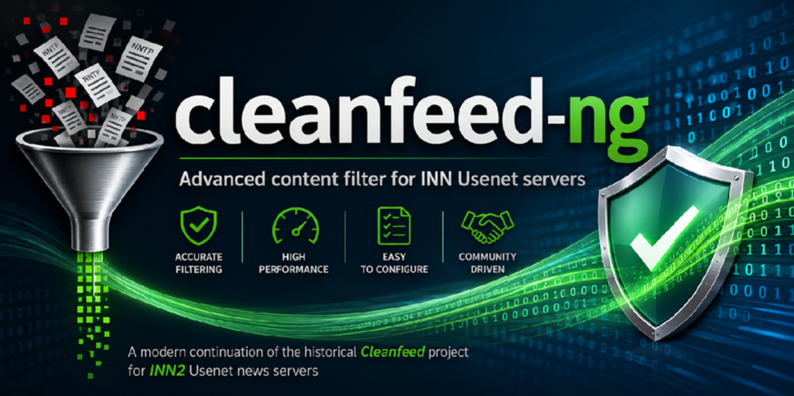

<p align="center">
  <a href="https://github.com/infybofh/cleanfeed-ng">
    
  </a>


[](LICENSE)


</p>

# cleanfeed-ng

`cleanfeed-ng` is a maintained, lightweight continuation of the historical Cleanfeed filter for the Perl filtering interface of INN `innd`. It is designed for server-to-server Usenet transit filtering, with particular attention to predictable behaviour, low overhead, safe configuration changes, and useful diagnostics.

> **Current release:** `2026.10.1` — first October 2026 CalVer release.  Available from the project Releases page once published.  
> **Runtime:** Perl 5.38 or newer; Ubuntu 24.04 LTS is the minimum supported platform baseline.

> [!IMPORTANT]
> cleanfeed-ng requires the Perl interpreter **embedded in `innd`** to be
> version 5.38 or newer. The one-time runtime banner reports the actual embedded
> version as `perl=v...`. Changing `/usr/bin/perl` or `update-alternatives` does
> not replace the interpreter already loaded by a running `innd`; restart INN
> completely after any Perl or libperl change.

## Project goals

- Preserve the practical philosophy and proven filtering model of Cleanfeed.
- Correct long-standing defects and modernize the implementation for current INN systems.
- Keep the synchronous `innd` hot path lightweight: no network calls, databases, HTTP services, antivirus engines, or other blocking dependencies.
- Make new heuristics observable before enforcement through `audit` mode.
- Emit granular, stable `CF-*` reason codes so administrators can identify the exact rule that matched.
- Provide exhaustive, heavily commented examples suitable for both experienced newsmasters and new administrators.

## Highlights

- Improved yEnc, MIME, Base64, uuencode, and misplaced-binary detection.
- Correct multipart yEnc metadata validation without comparing a complete-file size to a single article part.
- Peer- and hierarchy-based policies with `off`, `audit`, `quarantine`, and `reject` modes.
- Safe external regex loading with validation and last-known-good retention.
- Trusted-source lists with granular bypass controls.
- Bounded counters, CSV and key/value statistics, structured syslog events, and an HTML statistics page.
- Atomic state/statistics writes and configuration fingerprinting.
- Standalone configuration and article-inspection tooling.
- Comment-only `bad_*` and `trusted_*` examples that are safe to copy before customization.

## 2026.10.1 release focus

The October 2026 release promotes the production-tested RC3 work and adds three
important correctness/operational fixes:

- **Followup-aware crosspost arithmetic:** `fupcnt` keeps its historical Cleanfeed
  meaning (effective followup targets), while meow/topic subtraction now uses
  classifications counted from the same Followup-To set.  This removes an
  inherited bug that could produce incorrect or even negative off-topic counts
  when `Followup-To` differed from `Newsgroups`.
- **Immediate runtime reports:** the first successful article after load/reload
  forces fresh HTML, legacy text, key/value status, and CSV output so the files
  immediately describe the version and configuration actually running.
- **RFC Path diag-match support:** RFC 5536/5537 `!!` is recognized as valid
  `diag-match` syntax rather than an empty Path component.

The RC3 PHN identity hierarchy remains in place: per-poster metadata is preferred
and the shared-injector fallback is audit-only by default.

## Versioning

cleanfeed-ng uses **Calendar Versioning (CalVer)**:

```text
YYYY.MM.N[-alN|-beN|-rcN]
```

- `YYYY` — release year;
- `MM` — release month;
- `N` — sequential release number in that month, starting at 1;
- optional suffixes identify alpha, beta, or release-candidate builds.

Examples: `2026.10.1`, `2026.10.2`, `2026.11.1-rc1`.
Historical July 2026 labels are retained unchanged in old release notes and tags.

## Start here

1. Read the complete installation and operational guide: [`README.txt`](README.txt).
2. Review every setting in the canonical configuration reference: [`cleanfeed.local.example`](cleanfeed.local.example).
3. Read the reason-code reference: [`docs/REASON-CODES.md`](docs/REASON-CODES.md).
4. For Perl regex examples, see [`docs/REGEX-COOKBOOK.md`](docs/REGEX-COOKBOOK.md) when present and [`samples/README.txt`](samples/README.txt).
5. Begin new or changed policies in `audit` mode and inspect real traffic before enabling `reject`.

## Code navigation for reviewers

The runtime is intentionally kept mostly in one `cleanfeed` file because INN
loads it directly.  To find a rule quickly:

- start with [`docs/REASON-CODES.md`](docs/REASON-CODES.md), which now maps each
  public `CF-*` code/rule family to the function or source area that emits it;
- search `reject_code` for the authoritative rule-to-code mapping;
- search `reject(` for legacy deterministic rejects and `mode_result(` /
  `apply_finding_set(` for audit/reject-capable modern findings;
- EMP logic is grouped under the `apply_*_filter` routines; PHN identity
  selection is in `phn_identity_for_article`;
- group classification is in `classify_group_primary_uncached`,
  `classify_group_followup_uncached`, and `followup_policy_counts`;
- report generation is in `write_metrics`, `write_html_stats`, and `writestats`.

This map is also intended for people reviewing the code without prior Cleanfeed
history; human-readable reject text is not a stable API, while rule names and
`CF-*` codes are.

## Configuring `CLEANFEED_CONFIG_DIR`

`cleanfeed-ng` reads `cleanfeed.local` and the external `bad_*` / `trusted_*`
files from the directory selected by the `CLEANFEED_CONFIG_DIR` environment
variable.

Its behaviour is:

```text
CLEANFEED_CONFIG_DIR=/some/path   use /some/path
CLEANFEED_CONFIG_DIR=''           disable all external configuration files
variable not set                  use /usr/local/news/cleanfeed/etc
```

The empty value is mainly useful for syntax checks and tests. For a real INN
installation, set an explicit directory in the environment of the **innd
service**. On Debian or Ubuntu installations using the `inn2` systemd service:

```sh
sudo systemctl edit inn2
```

Add:

```ini
[Service]
Environment="CLEANFEED_CONFIG_DIR=/etc/news/filter/cleanfeed-ng"
```

Then apply it with a full restart:

```sh
sudo systemctl daemon-reload
sudo systemctl restart inn2
```

Verify the environment inherited by the running `innd` process:

```sh
sudo sh -c 'tr "\\0" "\\n" < /proc/$(pidof innd)/environ | \
  grep "^CLEANFEED_CONFIG_DIR="'
```

> [!IMPORTANT]
> `ctlinnd reload filter.perl` reloads the Perl filter and its configuration,
> but it cannot change environment variables already inherited by the running
> `innd` process. After adding or changing `CLEANFEED_CONFIG_DIR` in systemd or
> another startup script, restart INN completely once. Later changes inside
> `cleanfeed.local` only require the normal filter reload.

On systems not using systemd, export the variable in the script or service
manager that starts `innd`. Editing the fallback `$config_dir` directly in
`cleanfeed` also works, but is discouraged because a later repository update
may overwrite that local modification.

## Perl version and failed-load diagnostics

cleanfeed-ng performs a bootstrap check before normal initialization. If the
Perl interpreter used by `innd` is older than 5.38, loading is aborted and an
explicit message is sent to the INN error log, for example:

```text
filter: cleanfeed-ng fatal: Perl 5.38.0 or newer is required; the running interpreter is v5.34.0; filter not loaded
```

Check `news.err`, the system journal, and the general system log after a failed
reload. A successful first article after load or reload produces a one-time
runtime line similar to:

```text
filter: cleanfeed-ng runtime version=2026.10.1 perl=v5.38.2 initialization=ok ...
```

The version printed by `perl -V` in an interactive shell may differ from the
libperl already embedded in a running `innd`. After changing Perl alternatives,
packages, or libperl, use a full INN restart rather than only
`ctlinnd reload filter.perl`.

## Effective rejection and INN `dontrejectfiltered`

A non-empty value returned by `filter_art()` is a cleanfeed-ng rejection
**verdict**, but INN controls the final local disposition.  When `inn.conf`
contains:

```text
dontrejectfiltered: true
```

INN accepts articles rejected by its Perl or Python filter and may store them
locally, optionally in a storage class marked `filtered`.  This is useful for
quarantine or analysis installations, but it is incompatible with a server
whose filter verdicts must categorically prevent local storage.

cleanfeed-ng reads the effective setting once during initialization, outside the
recurring article path.  The runtime banner includes:

```text
dontrejectfiltered=0|1|unknown
```

When it detects `1`, it emits a one-time warning to the INN news log and repeats
the warning in the HTML and legacy text reports.  The key/value metrics snapshot
also contains `inn_dontrejectfiltered=`.

For effective rejection, set:

```text
dontrejectfiltered: false
```

Changes to `inn.conf` require an `innd` restart or `ctlinnd xexec innd`; a Perl
filter reload alone does not apply them.  When `dontrejectfiltered` is enabled,
cleanfeed-ng's `rejected` metrics count filter verdicts, not necessarily
articles discarded from local history, overview, or storage.

## Default reports, metrics, and debug paths

The current defaults enable the lightweight reports and use these locations:

```text
/var/www/cleanfeed.stat
/var/www/cleanfeed.html
/var/log/news/cleanfeed.status
/var/log/news/cleanfeed-statistics.csv
/var/spool/news/cleanfeed/
```

At the first article after load or reload, cleanfeed-ng prepares the configured
parent directories and output files when the INN runtime user has permission.
If it cannot create or update a path, it emits a clear one-time diagnostic to
the news log telling the newsmaster to fix ownership/permissions or disable the
corresponding option.

`/var/www` is commonly owned by root and intentionally not writable by `news`.
In that case, pre-create the two web files rather than making the entire web
root writable:

```sh
sudo install -o news -g news -m 0644 /dev/null /var/www/cleanfeed.stat
sudo install -o news -g news -m 0644 /dev/null /var/www/cleanfeed.html
sudo install -d -o news -g news -m 0750 /var/spool/news/cleanfeed
```

When the parent of an existing HTML/status file is not writable, cleanfeed-ng
uses a direct overwrite instead of atomic rename and reports that fallback once.
The metrics files under `/var/log/news` remain atomic when that directory is
writable by `news`.

> [!WARNING]
> The legacy text file `cleanfeed.stat` includes current configuration values
> and summaries of loaded rule lists. Do not expose it publicly unless that is
> intentional. The HTML report contains operational counters and is the safer
> page to publish.

Set any path to an empty string to disable that output. Set
`debug_batch_directory => ''` to disable debug batch capture.

## PHN posting identity and safe fallback

The PHN detector counts repeated articles to the same sorted Newsgroups distribution. A shared news service is not a poster identity: using only an injector such as `news.example.net` can merge thousands of unrelated users into one counter.

PHN therefore prefers, in order:

1. `Injection-Info` `posting-account`;
2. `Injection-Info` `posting-host`;
3. `NNTP-Posting-Host`;
4. a Path token of the form `.POSTED.<source>`.

Those values are namespaced by injector and may enforce the normal PHN threshold. When none exists, `phn_weak_identity_mode => 1` keeps the shared-injector/Newsgroups key as an audit signal only. Set it to `0` to disable that weak signal. `phn_aggressive => 1` deliberately restores the legacy weak-identity reject and emits a startup warning; it is not recommended for public or multi-user injectors.

Local group exclusions remain available through `phn_exclude`. Append narrowly scoped exceptions in `cleanfeed.local`, for example:

```perl
$config_append{phn_exclude} =
    '|^fr\.soc\.politique$|^de\.soc\.politik\.misc$';
```

The examples are not shipped policy recommendations. Exclude a complete group only after inspecting real traffic; otherwise leave the weak fallback in audit mode and retain strong-identity PHN enforcement.

PHN structured events include fields such as:

```text
cleanfeed_event action=audit rule=emp.phn ... message_id=<...> identity_source=shared_injector identity_strength=weak identity_hash=... count=151 cutoff=150 reason="EMP shared-injector/newsgroups threshold exceeded"
```

The hash permits correlation without logging the account or host identity in clear text. It is not a secret token or an anonymization guarantee.

## Quick verification

From the extracted package directory:

```sh
CLEANFEED_CONFIG_DIR='' perl -c cleanfeed
perl -c cleanfeed.local.example
perl -c cleanfeed-admin.pl
prove -v tests
sha256sum -c MANIFEST-SHA256.txt
```

The checksum manifest is intentionally deployment-focused. It covers the runtime filter, administrative/helper programs, canonical configuration, and operator-editable sample/list files. Repository metadata, GitHub templates, prose documentation, licensing text, central-list project scaffolding, and tests are deliberately not included in that manifest.

## Documentation

- [`README.txt`](README.txt) — installation, deployment, rollback, configuration, logging, statistics, and operational guidance.
- [`cleanfeed.local.example`](cleanfeed.local.example) — exhaustive parameter reference with extensive comments and examples.
- [`TECHNICAL-REVIEW.md`](TECHNICAL-REVIEW.md) — implementation review and design notes.
- [`CHANGELOG.md`](CHANGELOG.md) — release history.
- [`CONTRIBUTING.md`](CONTRIBUTING.md) — contribution and review expectations.
- [`SECURITY.md`](SECURITY.md) — security reporting and deployment assumptions.

## Safety and performance

The filter runs synchronously inside the INN article path. Expensive work is bounded where possible, shared scan windows are cached per article, disabled checks should avoid body inspection, and periodic reports are not generated for every article. Nevertheless, every site has different traffic. Use `audit` first, monitor CPU and log volume, and validate representative traffic before promoting a rule to `reject`.

No content detector can identify every deliberately encrypted or arbitrarily obfuscated payload without risking false positives. Content checks should be combined with narrow hierarchy/peer policy, conservative limits, and site-specific evidence.

## Project history and credit

Cleanfeed was originally developed by **Jeremy Nixon**, who maintained it until 1998. Further development was then taken on by **Marco d'Itri**, followed by later updates and maintenance by **Steve Crook**. Their original credit and copyright notices are retained in the source.

`cleanfeed-ng` continues that historical work. The goal is not to erase or replace it, but to keep a proven INN transit filter maintained, testable, understandable, and useful on current systems.

## Contributing

Bug reports, false-positive reports, performance measurements, documentation fixes, tests, and code contributions are welcome. Please include the exact version, relevant `CF-*` code, sanitized log lines, configuration context, and enough article structure to reproduce the issue without publishing private data.

See [`CONTRIBUTING.md`](CONTRIBUTING.md) before submitting changes.

## License

Distributed under the license included in [`LICENSE`](LICENSE), while retaining the notices and terms applicable to the original Cleanfeed code.
